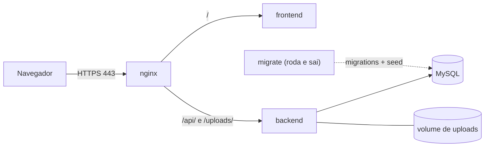

# Moonlight DevOps

Infraestrutura da loja Moonlight em containers: banco, API, frontend e um Nginx como única porta de entrada, tudo em HTTPS local (`https://moonlight.local`).

Este repositório **não contém regra de negócio nem schema de banco**. O código vive nos repositórios de backend e frontend (copiados aqui em `Moonlight_Backend/` e `Moonlight_Frontend_React/`), e o schema vive nas migrations do backend.

---

## Subindo o ambiente

1. **Variáveis:** copie `.example.env` para `.env` e preencha.
2. **Host local:** adicione `127.0.0.1 moonlight.local` ao arquivo de hosts do sistema.
3. **Certificados:** os arquivos `nginx/certs/moonlight.local.pem` e `moonlight.local-key.pem` precisam existir. Se não existirem:
   ```bash
   mkcert -install
   mkcert -cert-file nginx/certs/moonlight.local.pem -key-file nginx/certs/moonlight.local-key.pem moonlight.local
   ```
4. **Subir:**
   ```bash
   docker compose up -d --build
   ```
5. **Acessar:** https://moonlight.local

Para carregar dados de exemplo (jogos, categorias e o usuário admin de teste), coloque `RUN_SEED=true` no `.env` antes do passo 4. **Nunca em produção.**

---

## Como as peças se conectam



| Serviço | Container | Função | Exposto ao host |
| :-- | :-- | :-- | :-: |
| `nginx` | `nginx_service` | Proxy reverso, HTTPS e cabeçalhos de segurança | 80, 443 |
| `frontend` | `frontend_service` | Interface React | não |
| `backend` | `backend_service` | API (porta 3000 só na rede interna) | não |
| `database` | — | MySQL 8 | não |
| `migrate` | `migrate_service` | Aplica migrations (e seed, se pedido) e termina | não |

**Ordem de inicialização:** `database` fica saudável (healthcheck) → `migrate` roda e termina com sucesso → `backend` sobe → `frontend` e `nginx`.

---

## Banco de dados

O schema **pertence ao backend**. O banco nasce vazio e o serviço `migrate` aplica os arquivos de `database/migrations/` do backend, em ordem, a cada `docker compose up`. É seguro repetir: só roda o que ainda não foi aplicado.

- **Seed de exemplo:** só roda com `RUN_SEED=true`, e é idempotente.
- **Resetar tudo:** `docker compose down -v` apaga o banco **e os uploads**; depois `docker compose up -d --build`.
- **Conferir o que foi aplicado:** `SELECT * FROM schema_migrations;`
- **Acessar pelo DBeaver ou outro cliente:** o banco não é publicado por padrão. Crie um `docker-compose.override.yml` (opcional, só para desenvolvimento):
  ```yaml
  services:
    database:
      ports:
        - "3306:3306"
  ```

---

## Nginx

| Caminho | Destino |
| :-- | :-- |
| `http://moonlight.local` | redireciona para HTTPS |
| `/` | frontend |
| `/api/` | backend |
| `/uploads/` | backend (imagens enviadas) |

- O limite de upload no Nginx (`client_max_body_size 6m`) fica acima do limite da API (5 MB).
- Cabeçalhos aplicados: `X-Frame-Options`, `X-Content-Type-Options`, `Referrer-Policy`, `Content-Security-Policy`, `Strict-Transport-Security`. A configuração completa está em `nginx/nginx.conf`.

---

## Redes e volumes

| Nome | Tipo | Quem usa | Para quê |
| :-- | :-- | :-- | :-- |
| `proxy_network` | rede | nginx, frontend, backend | tráfego de entrada |
| `db_network` | rede | backend, migrate, database | só quem precisa falar com o banco |
| `db-data` | volume | database | dados do MySQL |
| `uploads-data` | volume | backend | imagens enviadas pelos usuários |

---

## Variáveis de ambiente

| Variável | Usada por | Para quê |
| :-- | :-- | :-- |
| `DB_ROOT_PASSWORD` | database | senha root do MySQL |
| `DB_DATABASE_NAME` | database, backend, migrate | nome do banco |
| `DB_USER`, `DB_PASSWORD` | database, backend, migrate | credenciais da aplicação |
| `JWT_SECRET` | backend | assinatura dos tokens de login |
| `MERCADOPAGO_ACCESS_TOKEN` | backend | API do Mercado Pago |
| `NGROK_URL` | backend | URL pública para webhook e retorno do pagamento |
| `RUN_SEED` | migrate | `true` carrega dados de exemplo (padrão `false`) |
| `VITE_API_URL` | frontend (build) | endereço da API, **sem barra no final** |
| `VITE_USE_MOCK` | frontend (build) | `true` usa serviços falsos |
| `VITE_MP_PUBLIC_KEY` | frontend (build) | chave pública do Mercado Pago |

As variáveis `VITE_*` são embutidas no build: mudar uma delas exige `docker compose up -d --build`.

---

## Qualidade

**Local (Husky)**
- `commit-msg`: exige o formato `tipo(escopo opcional): descrição`, com tipo em `feat`, `fix`, `chore`, `docs`, `refactor`, `test` ou `hotfix`.
- `pre-push`: exige os containers rodando e executa `npm run test:e2e`. Se falhar, o push é bloqueado.

**CI (GitHub Actions, `.github/workflows/playwright.yml`)**
Roda em push e pull request para `main` e `develop`, e manualmente. O fluxo: monta o `.env` a partir dos secrets, gera os certificados com mkcert, sobe o Compose (com `RUN_SEED=true`), espera o HTTPS responder e roda o Playwright. O relatório fica salvo como artefato por 30 dias.

Os testes e2e (`tests/e2e/`) cobrem login, cadastro e o CRUD administrativo de jogos e categorias.

---

## Comandos úteis

| Objetivo | Comando |
| :-- | :-- |
| Subir (reconstruindo imagens) | `docker compose up -d --build` |
| Derrubar | `docker compose down` |
| Derrubar apagando dados | `docker compose down -v` |
| Logs de um serviço | `docker compose logs -f backend` |
| Ver se as migrations rodaram | `docker compose logs migrate` |
| Testes e2e | `npm run test:e2e` |

---

## Problemas comuns

| Sintoma | Causa provável | O que fazer |
| :-- | :-- | :-- |
| Backend não sobe | `migrate` falhou | `docker compose logs migrate` |
| Erro de coluna ou tabela inexistente | volume com schema antigo | `docker compose down -v` e subir de novo |
| Upload responde 413 | limite do Nginx | conferir `client_max_body_size` |
| Imagem enviada abre a página do frontend | falta o `location /uploads/` | conferir `nginx.conf` |
| Imagens somem após rebuild | volume de uploads ausente | conferir `uploads-data` no backend |
| Navegador desconfia do certificado | mkcert não instalado | `mkcert -install` e gerar os certificados de novo |
| `moonlight.local` não abre | host não configurado | conferir o arquivo de hosts |
| Mudei `VITE_*` e nada mudou | variáveis entram no build | subir com `--build` |

---

## Decisões de arquitetura

| Decisão | Motivo |
| :-- | :-- |
| Nginx como única entrada | centraliza HTTPS, roteamento e cabeçalhos; nenhum outro serviço é publicado |
| Duas redes separadas | só o backend e o migrate enxergam o banco |
| Schema fica no backend; o DevOps só executa | uma fonte de verdade; evita cópia de SQL desatualizada |
| Migrations por serviço `migrate`, não por init do MySQL | o init do MySQL só roda com volume vazio e nunca aplicaria migrations novas |
| Seed opcional (`RUN_SEED`) | dado de exemplo e credencial de teste só existem em dev e na CI |
| Banco publicado só via override | mantém o Compose principal próximo de produção |
